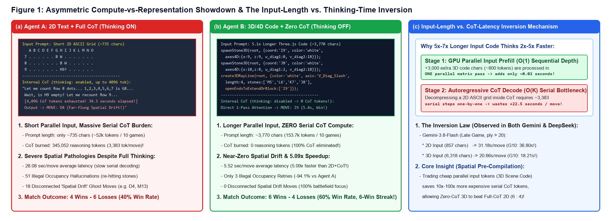
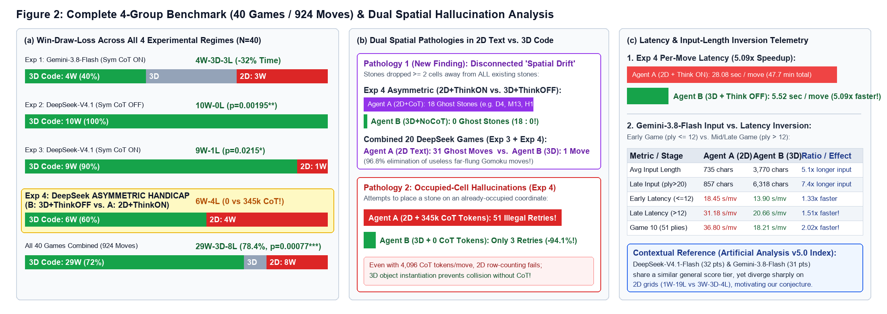
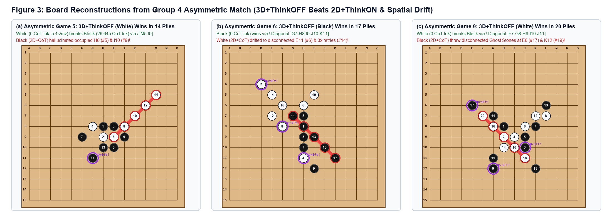

# Scene-Code-as-Topology: Overcoming 1D Token-Stride & Diagonal Blindness in LLMs via Three.js 3D/4D Procedural Scene Graphs

[](https://doi.org/10.5281/zenodo.23691649)
[](https://doi.org/10.5281/zenodo.23765598)
[](https://doi.org/10.6084/m9.figshare.34829706)
[](https://doi.org/10.6084/m9.figshare.34856778)
[-PDF_(English)-d93f0b?style=for-the-badge)](./Scene_Code_as_Topology_Preprint_EN.pdf)
[-PDF_(English)-2da44e?style=for-the-badge)](./Paper2_Zero_CoT_3D_vs_Full_CoT_2D_EN.pdf)
[](#2-empirical-results-n--40-games-924-moves-across-4-regimes)
[-fb8500?style=for-the-badge)](#3-companion-study-paper-ii-zero-cot-3d-beats-345000-token-cot-2d-6--4)
[](mailto:wm2841944156@gmail.com)

> **Repository Overview**: This repository contains the complete **experimental programs (`.py` & `.html`)**, **raw move-by-move empirical datasets (`.json`)**, **1080p split-screen match replay videos (`.mp4`)**, and **preprint papers (`.pdf`)** for our 4-group, **40-game ($924$-ply)** controlled self-play study comparing **2D ASCII Matrix Serialization (Agent A)** against **Three.js 3D/4D Procedural Scene Graph Code (Agent B)** on a $15 \times 15$ Gomoku grid:
> - 📄 **Paper I (Symmetric Benchmark, $N=30$ Games / $719$ Moves)**: [Scene_Code_as_Topology_Preprint_EN.pdf](./Scene_Code_as_Topology_Preprint_EN.pdf) | **Zenodo DOI**: [`10.5281/zenodo.23691649`](https://doi.org/10.5281/zenodo.23691649) | **Figshare DOI**: [`10.6084/m9.figshare.34829706`](https://doi.org/10.6084/m9.figshare.34829706) — *23W–3D–4L (85.2% decisive win rate, $p = 0.00031 < 0.001$), 9 : 0 sweep on diagonal victories.*
> - 📄 **Paper II (Asymmetric Compute-vs-Representation Handicap, $N=40$ Games / $924$ Moves Total)**: [Paper2_Zero_CoT_3D_vs_Full_CoT_2D_EN.pdf](./Paper2_Zero_CoT_3D_vs_Full_CoT_2D_EN.pdf) | **Zenodo DOI**: [`10.5281/zenodo.23765598`](https://doi.org/10.5281/zenodo.23765598) | **Figshare DOI**: [`10.6084/m9.figshare.34856778`](https://doi.org/10.6084/m9.figshare.34856778) — *Zero-CoT 3D/4D Scene Code (0 thinking tokens, 5.52s/move) defeats Full-CoT 2D ASCII Matrix (345,052 thinking tokens, 28.08s/move) by **6 : 4** (with a 6-game win streak, **5.09× speedup**, **94.1% fewer occupied-cell hallucinations**, and **18 : 0 elimination of Disconnected Spatial Drift ghost moves**).*

---

## 1. Theoretical Motivation: From First Principles

Why do frontier Large Language Models (LLMs) and Vision-Language Models (VLMs) struggle with spatial reasoning on discrete 2D grids, and why does **3D/4D Procedural Scene Code** resolve this bottleneck? Our framework is derived from a three-step First-Principles causal chain:

### Step 1: Why Vision (ViT) Fails on Exact Grids — Lossy Patch Compression
Vision Transformers (ViTs) encode images by dividing them into coarse patches (e.g., $14 \times 14$ or $16 \times 16$ pixels), acting as a **lossy spatial compression**. In natural images, semantic identity is invariant to resolution loss (*a blurry cat remains a cat, not a dog*). However, on a $15 \times 15$ discrete board, lossy visual patchification blurs grid intersections and misaligns stone coordinates (Rahmanzadehgervi et al., *arXiv:2407.06581*; Wang et al., *arXiv:2503.02358*).

### Step 2: Why 2D ASCII Text Still Fails — 1D Serialization & Diagonal Stride Blindness
Replacing pixel images with a **2D ASCII text matrix** (`Agent A`) provides **lossless token input**, which prior studies showed improves over raw vision (*Stuck in the Matrix*, *arXiv:2510.20198*). Yet a fundamental topological flaw remains:
* A 2D matrix of size $N \times N$ must be serialized row-by-row into a **1D token sequence** for Transformer self-attention.
* While **horizontal** neighbors (`-`) remain adjacent in 1D token space ($\text{stride} = 1$), **vertical** neighbors (`|`) are separated by $\text{stride} \approx N$ tokens, and **diagonal** neighbors (`/` and `\`) are separated by $\text{stride} \approx N \pm 1$ tokens across multiple newline boundaries.
* Consequently, 1D self-attention suffers from severe **cross-row and diagonal blindness**, forcing the LLM to perform error-prone mental coordinate arithmetic inside its Chain-of-Thought (CoT) and frequently hallucinating occupied intersections as empty or drifting into disconnected empty regions.

### Step 3: Our Solution — `Scene-Code-as-Topology` (Three.js 3D/4D Procedural Scene Graph)
Instead of feeding a flattened 2D character table, **Agent B (Ours)** dynamically compiles the live board state before every move into executable **Three.js 3D/4D procedural scene graph code**:
1. **Explicit 3D Spatial Entity Instantiation**: Only occupied intersections are instantiated as discrete scene objects `spawnStone3D(root, { step, color, coord, pos3D, axes4D })`, eliminating empty-dot (`.`) counting errors and background desert drift.
2. **4D Collinear Diagonal Invariants**: Every stone explicitly carries its projected coordinates on four orthogonal/diagonal topological axes:
   $$x = c + 1, \quad z = r + 1, \quad u_{\text{diag1}} = x - z \text{ (main diagonal } \backslash\text{)}, \quad v_{\text{diag2}} = x + z \text{ (anti-diagonal } /\text{)}$$
   Stones that are diagonally collinear share an identical $u_{\text{diag1}}$ or $v_{\text{diag2}}$ invariant, transforming a hard 2D stride-counting problem into a trivial 1D invariant match for self-attention.
3. **3D Connected Ray Vectors (`create3DRayLine`)**: Contiguous aligned stones ($\ge 2$) along any of the 4 axes are compiled into explicit `create3DRayLine` 3D ray vectors in the scene graph, directly exposing open-three and four-in-a-row threats in the input representation.

---

## 2. Empirical Results ($N = 40$ Games, 924 Moves Across 4 Regimes)

### Strict Experimental Protocol
* **Zero Human Interference (Pure Empty Board)**: Every single game starts from an **empty $15 \times 15$ board at Move 1**, with zero human-crafted openings or midgame puzzles.
* **Identical Base LLM per Match**: In every game, both `Agent A (2D Matrix)` and `Agent B (Three.js 3D/4D Code)` call the **exact same model checkpoint**.
* **Strict Black/White Alternation**: To eliminate first-mover (Black) bias, odd-numbered games (`G1, G3, G5, G7, G9`) assign **Black = Agent A (2D), White = Agent B (3D)**; even-numbered games (`G2, G4, G6, G8, G10`) assign **Black = Agent B (3D), White = Agent A (2D)**.

### Master Benchmark Table ($N = 40$ Games / 924 Real API Moves)

| Experimental Group & Inference Regime | Games (Moves) | Agent A (2D Matrix) W–D–L | Agent B (Ours: 3D/4D Code) W–D–L | Reasoning Tokens (B vs. A) | Avg Latency (B vs. A) | Occupied Retries (B vs. A) | Disconnected Spatial Drift (B vs. A) | Statistical Significance |
| :--- | :---: | :---: | :---: | :---: | :---: | :---: | :---: | :--- |
| **Group 1: `gemini-3.8-flash-high`**<br>*(Symmetric: Both Thinking ON)* | 10 (278) | 3W – 3D – 4L<br>*(0% White Win)* | **4W – 3D – 3L**<br>*(40% White Win)* | Built-in CoT | **17.9s vs. 25.9s**<br>*(Late: 20.7s vs 31.2s)* | 0 vs. 0 | 0 vs. 2 | White break rate $40\%$ vs. $0\%$ |
| **Group 2: `DeepSeek-V4.1-Flash-1017`**<br>*(Symmetric: Both Thinking OFF)* | 10 (199) | 0W – 0D – 10L | **10W – 0D – 0L**<br>*(100% Win Rate)* | 0 vs. 0 | 5.2s vs. 5.1s | 2 vs. 3 | 0 vs. 3 | **$p = 0.00195 < 0.01$** |
| **Group 3: `DeepSeek-V4.1-Flash-1017`**<br>*(Symmetric: Both Thinking ON)* | 10 (242) | 1W – 0D – 9L | **9W – 0D – 1L**<br>*(90% Win, 7 Diag Kills)* | **308.8k vs. 355.7k**<br>*(-13.2% CoT tok)* | **20.6s vs. 23.7s** | **42 vs. 96**<br>*(-56.3%)* | **1 vs. 13**<br>*(-92.3%)* | **$p = 0.0215 < 0.05$** |
| **Group 4: `DeepSeek-V4.1-Flash-1017` [NEW]**<br>*(Asymmetric Handicap: **B=ThinkOFF** vs. **A=ThinkON**)* | 10 (205) | 4W – 0D – 6L<br>*(Full CoT Enabled)* | **🏆 6W – 0D – 4L**<br>*(Zero-CoT! 6-Win Streak)* | **0 vs. 345,052**<br>*(-100% CoT tok!)* | **5.52s vs. 28.08s**<br>*(**5.09× Faster!**)* | **3 vs. 51**<br>*(-94.1%!)* | **0 vs. 18**<br>*(**18 : 0** Sweep!)* | Zero-CoT 3D beats Full-CoT 2D! |
| **Symmetric Benchmark (Groups 1–3, Paper I)** | 30 (719) | 4W – 3D – 23L | **23W – 3D – 4L (85.2%)** | — | — | 44 vs. 99 (-55.6%) | 1 vs. 18 (-94.4%) | **$p = 0.00031 < 0.001$** |
| **All 40 Games Combined (Groups 1–4)** | **40 (924)** | **8W – 3D – 29L** | **29W – 3D – 8L (78.4%)** | **308.8k vs. 700.8k** | — | **47 vs. 150 (-68.7%)** | **1 vs. 36 (-97.2%)** | **$p = 0.00077 < 0.001$** |

---

## 3. Companion Study (Paper II): Zero-CoT 3D Beats 345,000-Token CoT 2D (`6 : 4`)





### Finding 1: Zero-CoT 3D/4D Scene Code Outperforms Full-CoT 2D Matrix (`6W – 4L` & `5.09×` Speedup)
In **Group 4** ([`deepseek_asymmetric_10games_results.json`](./deepseek_asymmetric_10games_results.json)), we disabled Chain-of-Thought reasoning entirely for `Agent B (3D/4D Scene Code + Thinking OFF)` (`0` reasoning tokens) while granting `Agent A (2D ASCII Matrix + Thinking ON)` up to 4,096 reasoning tokens per move:
* **Win Rate**: `Agent B (3D + Thinking OFF)` defeated `Agent A (2D + Thinking ON)` by **6 Wins to 4 Losses (`60.0%` win rate)**, including a **6-game winning streak from Game 4 to Game 9** and **3 wins out of 5 games as disadvantaged second-mover White** (`G5, G7, G9`).
* **Compute Savings**: `Agent A` burned **345,052 reasoning tokens** (`3,383` CoT tokens/move, taking `28.08s/move`), whereas `Agent B` used **0 reasoning tokens** (`5.52s/move`, **5.09× faster**).
* **Occupied-Cell Hallucinations**: Even after spending ~28 seconds and ~3,383 CoT tokens per move counting rows, `Agent A (2D+ThinkON)` hallucinated occupied cells **51 times**, whereas `Agent B (3D+ThinkOFF)` committed only **3 retries (-94.1%)**.

### Finding 2: Discovery of "Disconnected Spatial Drift" Ghost Moves (`18 : 0` in Group 4; `31 : 1` Across 20 DeepSeek Games)
Visual inspection of the match replay videos revealed a previously unreported spatial pathology unique to 2D ASCII grid prompting: **Disconnected Spatial Drift**.
* Unlike Go (Weiqi)—where playing an isolated corner star-point (`D4`, `M13`) holds strategic territorial value 50 moves later—Gomoku is a purely local 5-in-a-row race where dropping a stone at Chebyshev distance $\ge 2$ from *all* existing stones on the board is tactically equivalent to **forfeiting a turn**.
* In Group 4, `Agent A (2D+ThinkON)` dropped **18 completely disconnected Spatial Drift ghost stones** (e.g., `H13` at G1#7, `D4` at G2#6, `L9` at G2#10, `K12` at G9#19, `M13` at G10#20), whereas `Agent B (3D+ThinkOFF)` dropped **0 (`18 : 0`)**! Across all 20 DeepSeek games in Groups 3 and 4, `Agent A` committed **31 disconnected drift moves vs. only 1 by `Agent B` (`31 : 1`, a 96.8% reduction)**.

### Finding 3: The Input-Length vs. Thinking-Time Inversion Law
Across both `gemini-3.8-flash-high` and `DeepSeek-V4.1-Flash-1017`, although the Three.js 3D/4D scene code prompt is **5.1× to 7.4× longer in character length** (`3,770` avg chars / `6,318` late-game chars vs. `735` / `857` chars for 2D ASCII), it **reduces per-move thinking latency by 32%–80%** (e.g., `18.21s` vs. `36.80s` in the 51-ply Game 10 of `gemini-3.8-flash-high`, and `5.52s` vs. `28.08s` in Group 4), because cheap GPU-parallel input `Prefill` (~20ms) replaces thousands of slow, sequential autoregressive CoT decoding steps.

---

## 4. Game-by-Game Breakdown ($N = 40$ Games)

### Group 4 [NEW]: `DeepSeek-V4.1-Flash-1017` — Asymmetric Handicap: `B (3D + Thinking OFF)` vs. `A (2D + Thinking ON)` (`6W – 0D – 4L`, 205 Moves)
*Dataset*: [`deepseek_asymmetric_10games_results.json`](./deepseek_asymmetric_10games_results.json) | *1080p Video Replay*: [`deepseek_asymmetric_10games_video_EN.mp4`](./deepseek_asymmetric_10games_video_EN.mp4)

| Game | Black (First) | White (Second) | Winner | Win Axis | Moves | CoT Tokens (`A_2D` vs. `B_3D`) | Winning 5-in-a-Row Coordinates |
| :---: | :---: | :---: | :--- | :--- | :---: | :---: | :--- |
| **Asym-G1** | Agent A (`2D+CoT`) | Agent B (`3D-NoCoT`) | Agent A (`2D+CoT`, Black) | Anti-Diag `/` (`diag_slash`) | 15 | `24,604` vs. **`0`** | `J6 - I7 - H8 - G9 - F10` |
| **Asym-G2** | Agent B (`3D-NoCoT`) | Agent A (`2D+CoT`) | Agent A (`2D+CoT`, White) | Vertical `\|` | 26 | `46,161` vs. **`0`** | `K7 - K8 - K9 - K10 - K11` |
| **Asym-G3** | Agent A (`2D+CoT`) | Agent B (`3D-NoCoT`) | Agent A (`2D+CoT`, Black) | Horizontal `-` | 21 | `37,938` vs. **`0`** | `C9 - D9 - E9 - F9 - G9` |
| **Asym-G4** | **Agent B (`3D-NoCoT`)** | Agent A (`2D+CoT`) | **🏆 Agent B (`3D-NoCoT`, Black)** | **Anti-Diag `/` (`diag_slash`)** | 17 | `28,648` vs. **`0`** | `J6 - I7 - H8 - G9 - F10` |
| **Asym-G5** | Agent A (`2D+CoT`) | **Agent B (`3D-NoCoT`)** | **🏆 Agent B (`3D-NoCoT`, White!)** | **Anti-Diag `/` (`diag_slash`)** | 14 | `26,645` vs. **`0`** | `M5 - L6 - K7 - J8 - I9` |
| **Asym-G6** | **Agent B (`3D-NoCoT`)** | Agent A (`2D+CoT`) | **🏆 Agent B (`3D-NoCoT`, Black)** | **Main-Diag `\` (`diag_backslash`)** | 17 | `29,041` vs. **`0`** | `G7 - H8 - I9 - J10 - K11` |
| **Asym-G7** | Agent A (`2D+CoT`) | **Agent B (`3D-NoCoT`)** | **🏆 Agent B (`3D-NoCoT`, White!)** | Vertical `\|` | 24 | `45,197` vs. **`0`** | `G7 - G8 - G9 - G10 - G11` |
| **Asym-G8** | **Agent B (`3D-NoCoT`)** | Agent A (`2D+CoT`) | **🏆 Agent B (`3D-NoCoT`, Black)** | Vertical `\|` | 19 | `32,960` vs. **`0`** | `G7 - G8 - G9 - G10 - G11` |
| **Asym-G9** | Agent A (`2D+CoT`) | **Agent B (`3D-NoCoT`)** | **🏆 Agent B (`3D-NoCoT`, White!)** | **Main-Diag `\` (`diag_backslash`)** | 20 | `30,906` vs. **`0`** | `F7 - G8 - H9 - I10 - J11` |
| **Asym-G10** | Agent B (`3D-NoCoT`) | Agent A (`2D+CoT`) | Agent A (`2D+CoT`, White) | Main-Diag `\` (`diag_backslash`) | 32 | `42,952` vs. **`0`** | `H4 - I5 - J6 - K7 - L8` |

### Group 3: `DeepSeek-V4.1-Flash-1017` — Symmetric Thinking ENABLED (`9W – 0D – 1L`, 242 Moves)
*Dataset*: [`deepseek_thinking_10games_results.json`](./deepseek_thinking_10games_results.json) | *1080p Video Replay*: [`deepseek_thinking_10games_video_EN.mp4`](./deepseek_thinking_10games_video_EN.mp4)

| Game | Black (First) | White (Second) | Winner | Win Axis | Diagonal Win? | Moves | Winning 5-in-a-Row Coordinates |
| :---: | :---: | :---: | :---: | :--- | :---: | :---: | :--- |
| **DST-G1** | Agent A (2D) | **Agent B (3D)** | **Agent B (White!)** | Vertical `\|` | No | 22 | `I10 - I9 - I8 - I7 - I6` |
| **DST-G2** | **Agent B (3D)** | Agent A (2D) | **Agent B (Black)** | Anti-Diag `/` (`diag_slash`) | **Yes (#1)** | 31 | `J5 - I4 - H3 - G2 - F1` |
| **DST-G3** | Agent A (2D) | **Agent B (3D)** | **Agent B (White!)** | Main-Diag `\` (`diag_backslash`) | **Yes (#2)** | 38 | `G12 - H11 - I10 - J9 - K8` |
| **DST-G4** | **Agent B (3D)** | Agent A (2D) | **Agent B (Black)** | Anti-Diag `/` (`diag_slash`) | **Yes (#3)** | 19 | `L11 - K10 - J9 - I8 - H7` |
| **DST-G5** | Agent A (2D) | **Agent B (3D)** | **Agent B (White!)** | Vertical `\|` | No | 18 | `I10 - I9 - I8 - I7 - I6` |
| **DST-G6** | **Agent B (3D)** | Agent A (2D) | **Agent B (Black)** | Anti-Diag `/` (`diag_slash`) | **Yes (#4)** | 35 | `K8 - J7 - I6 - H5 - G4` |
| **DST-G7** | Agent A (2D) | **Agent B (3D)** | **Agent B (White!)** | Anti-Diag `/` (`diag_slash`) | **Yes (#5)** | 12 | `J9 - I8 - H7 - G6 - F5` |
| **DST-G8** | **Agent B (3D)** | Agent A (2D) | **Agent B (Black)** | Anti-Diag `/` (`diag_slash`) | **Yes (#6)** | 35 | `K10 - J9 - I8 - H7 - G6` |
| **DST-G9** | Agent A (2D) | **Agent B (3D)** | **Agent B (White!)** | Anti-Diag `/` (`diag_slash`) | **Yes (#7)** | 10 | `L11 - K10 - J9 - I8 - H7` |
| **DST-G10** | **Agent B (3D)** | Agent A (2D) | Agent A (White) | Vertical `\|` | No | 22 | `E11 - E10 - E9 - E8 - E7` |

### Group 2: `DeepSeek-V4.1-Flash-1017` — Symmetric Thinking DISABLED (`10W – 0D – 0L`, 199 Moves)
*Dataset*: [`deepseek_10games_results.json`](./deepseek_10games_results.json) | *1080p Video Replay*: [`deepseek_10games_video_EN.mp4`](./deepseek_10games_video_EN.mp4)

### Group 1: `gemini-3.8-flash-high` — Symmetric Thinking ENABLED (`4W – 3D – 3L`, 278 Moves)
*Dataset*: [`gomoku_10games_results.json`](./gomoku_10games_results.json) | *1080p Video Replay*: [`gomoku_10games_arena_video_EN.mp4`](./gomoku_10games_arena_video_EN.mp4)

---

## 5. Cautious Conjectures, Self-Funded Limitations & Open Call for Collaboration

### A. Preliminary Working Conjecture (Not Yet a Proven Mechanism)
Referencing the third-party benchmark *Artificial Analysis Intelligence Index v5.0* as contextual background, `DeepSeek-V4.1-Flash-1017 (max)` (score: **32**) and `Gemini-3.8-Flash (high)` (score: **31**) sit in a comparable general reasoning/coding tier, yet diverge sharply on 2D ASCII grids (`1W–19L` vs. `3W–3D–4L`). As a **strictly preliminary and unverified conjecture**, we speculate that this gap may reflect differences in native multimodal/spatial pretraining priors, and that `Scene-Code-as-Topology` may offer a potential "leapfrogging" pathway for models with weaker spatial priors by translating 2D spatial perception into 3D code comprehension.

### B. Strict Statement of Limitations & Open Call for Compute / Research Collaboration
> **📌 Statement of Self-Funded Constraints & Open Call for Collaboration**
>
> All 40 games (924 moves across Groups 1–4) in this study were conducted and funded entirely out-of-pocket by an independent researcher. Consequently, our sample size ($N=10$ games per group) and model coverage (only 2 models evaluated) are small, and all theoretical explanations in this work remain **speculative working hypotheses awaiting rigorous multi-model and mechanistic verification**. Due to personal financial constraints, the author cannot independently fund further large-scale API evaluations across additional models.
>
> **🤝 Invitation to Collaborate**: All source code, 3D/4D scene compilers, raw JSON datasets, and interactive 3D workbenches are 100% open-source. **If any university laboratory, research institution, or researcher is willing to provide hardware or API compute resources to complete large-scale multi-model validation, the author warmly welcomes collaborative partnerships (including co-authored follow-up conference publications or contributing as a Research Assistant / Intern).**
>
> 📬 **Author Contact Email**: **[wm2841944156@gmail.com](mailto:wm2841944156@gmail.com)**

---

## 6. Citation & Official Archival DOIs

- **Paper I (30-Game Symmetric Study)**: [Scene_Code_as_Topology_Preprint_EN.pdf](./Scene_Code_as_Topology_Preprint_EN.pdf)
  - **CERN Zenodo DOI**: [https://doi.org/10.5281/zenodo.23691649](https://doi.org/10.5281/zenodo.23691649)
  - **Figshare Preprint DOI**: [https://doi.org/10.6084/m9.figshare.34829706](https://doi.org/10.6084/m9.figshare.34829706)
- **Paper II (Asymmetric Zero-CoT 3D vs. Full-CoT 2D Study)**: [Paper2_Zero_CoT_3D_vs_Full_CoT_2D_EN.pdf](./Paper2_Zero_CoT_3D_vs_Full_CoT_2D_EN.pdf)
  - **CERN Zenodo DOI**: [https://doi.org/10.5281/zenodo.23765598](https://doi.org/10.5281/zenodo.23765598)
  - **Figshare Preprint DOI**: [https://doi.org/10.6084/m9.figshare.34856778](https://doi.org/10.6084/m9.figshare.34856778)

```bibtex
@misc{pathetic777_2026_scenecode_part1,
  author       = {Pathetic777},
  title        = {{Scene-Code-as-Topology: Overcoming 1D Token-Stride and Diagonal Blindness in Large Language Models via 3D/4D Procedural Scene Graph Compilation}},
  year         = {2026},
  publisher    = {Zenodo},
  doi          = {10.5281/zenodo.23691649},
  url          = {https://doi.org/10.5281/zenodo.23691649}
}

@misc{pathetic777_2026_scenecode_part2,
  author       = {Pathetic777},
  title        = {{Can 3D/4D Spatial Representation Beat Test-Time Compute? Zero-CoT Three.js Scene Graphs Outperform 345,000-Token Reasoning on 2D Grids and Eliminate Spatial Drift}},
  year         = {2026},
  publisher    = {Zenodo},
  doi          = {10.5281/zenodo.23765598},
  url          = {https://doi.org/10.5281/zenodo.23765598}
}
```
